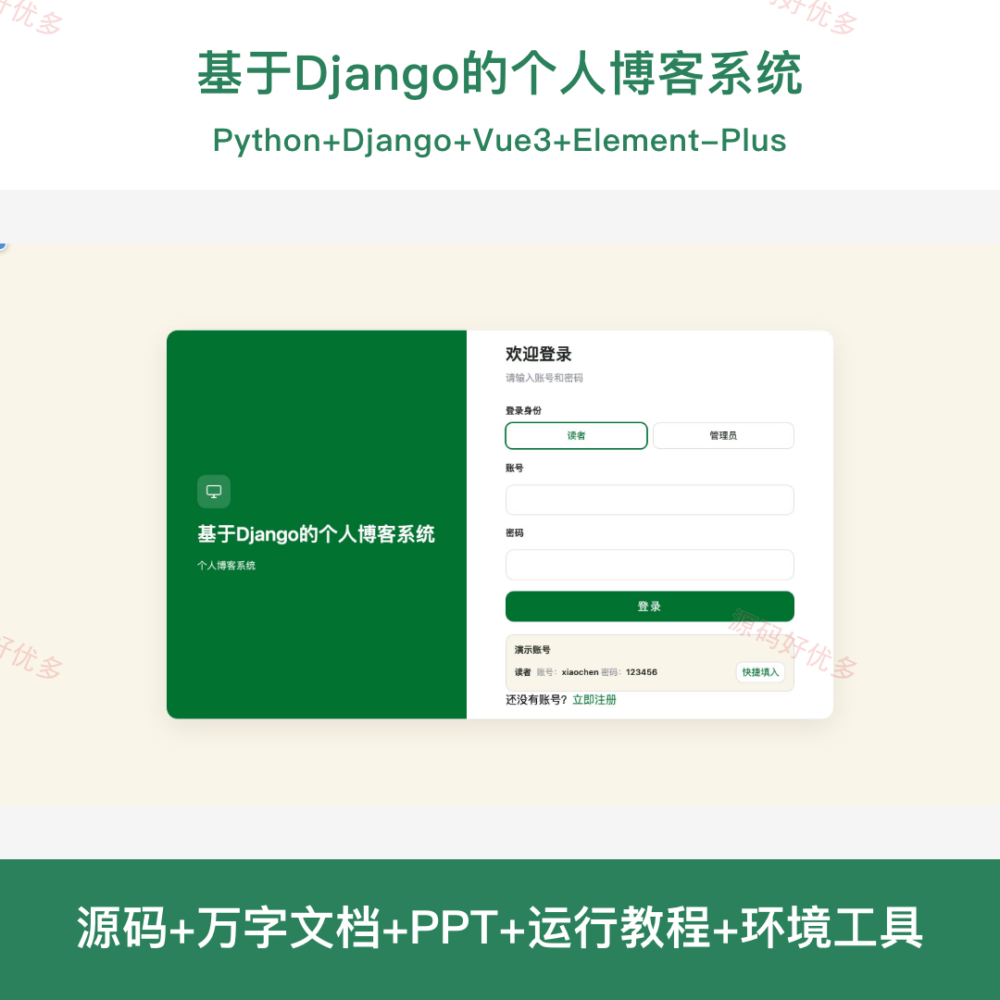
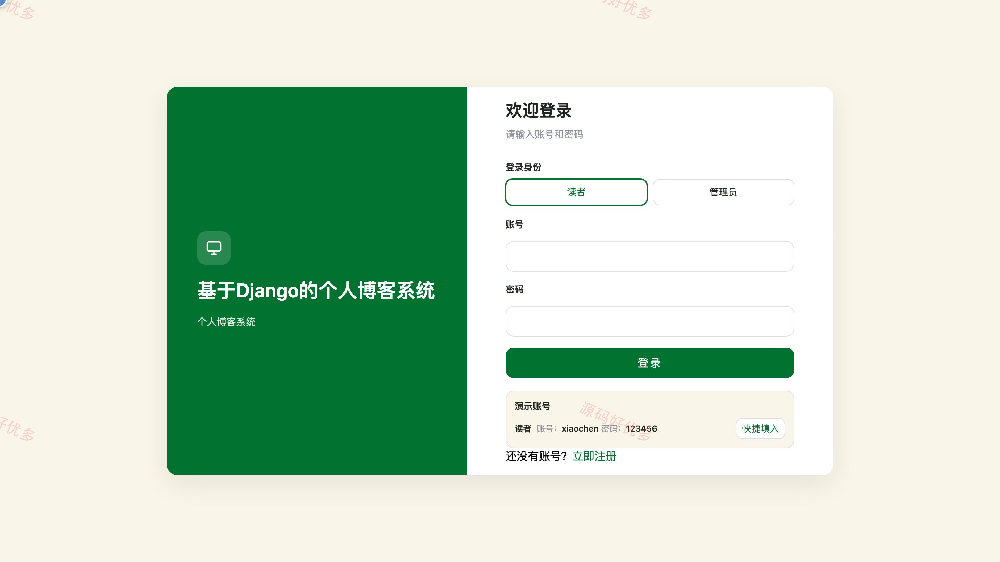
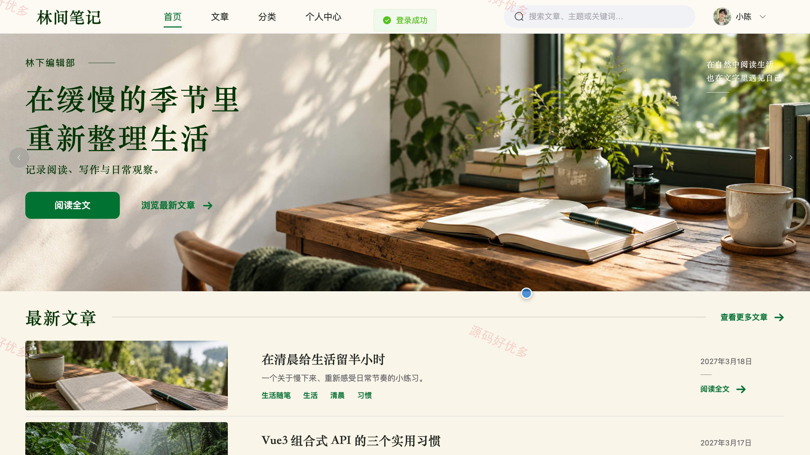
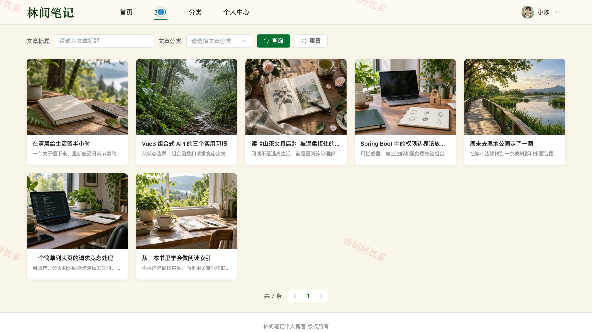
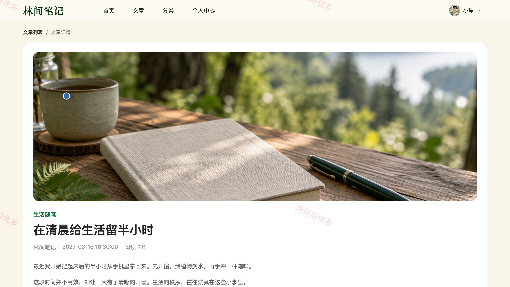
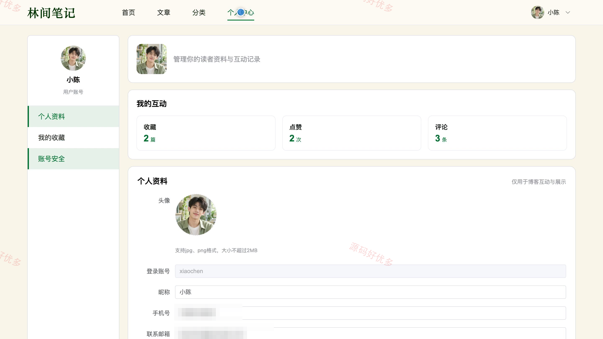
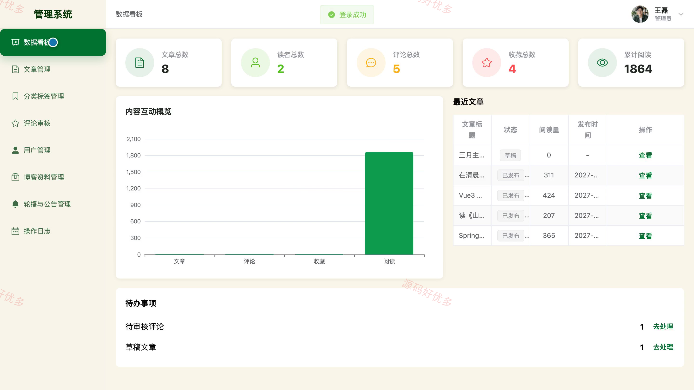
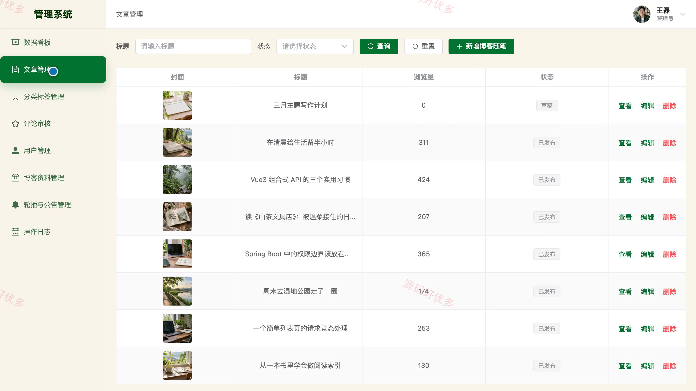
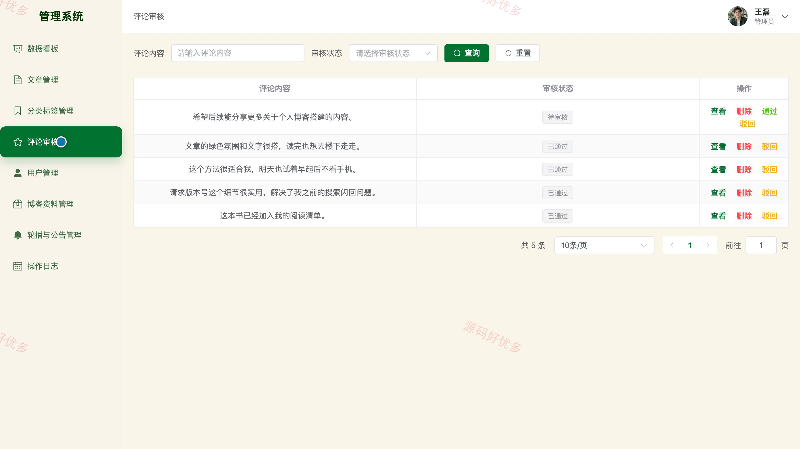

# bs118C
bs118C个人博客系统
## 源码问题查看主页咨询

### 一、关键词
个人博客、博客文章、随笔分享、阅读互动、内容发布

### 二、作品包含
源码+数据库+万字设计文档+PPT+全套环境和工具资源+本地部署教程

### 三、项目技术
前端技术： Html、Css、Js、Vue3.4、Element-Plus
后端技术：Python、Django

### 四、运行环境要求
开发工具：PyCharm + VSCODE

数据库：MySQL5.7+（共11张表）

数据库管理工具：Navicat10以上版本

环境配置软件： Python3+

前端Nodejs：16+

浏览器：谷歌浏览器

### 五、项目介绍
项目编号：bs118C

基于Django的个人博客系统面向读者与管理员，提供博客文章浏览、分类检索、收藏点赞、评论互动、个人资料维护以及文章发布与内容审核等功能，实现个人博客内容展示与读者互动的一体化管理。

角色：读者、管理员

读者功能：注册登录、首页与文章浏览、分类标签筛选、文章搜索、收藏点赞、评论互动、个人资料维护、收藏记录与密码管理。

管理员功能：后台登录与数据看板、文章发布与下架管理、分类标签管理、评论审核、读者账号状态管理、博客资料管理、轮播图与公告管理、操作日志查看。

### 六、运行截图

